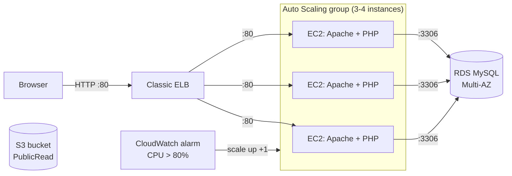

# QwinixTechChallenge

> **Archived (2016).** A technical-challenge infrastructure-as-code exercise kept for reference only. It is not
> maintained and should not be deployed as-is: it targets EC2-Classic, legacy instance types and AMI IDs from 2016.

An AWS CloudFormation template that provisions a load-balanced, auto-scaled Apache/PHP web tier with a MySQL RDS
database and an S3 bucket.

## Description

In March 2016 the Qwinix tech challenge asked for a single CloudFormation template, with its full
commit history on GitHub, that builds a small highly available web stack. This repository is that submission: the
template plus a README that walked the reviewer through each requirement with the matching template snippet.

It may still be of interest as an example of a pre-VPC-default CloudFormation (JSON, `cfn-init` / `cfn-hup`)
web stack.

## Features

Resources in `QwinixTech Challenge2.template`:

- **Elastic Load Balancer (Classic)**: HTTP listener on port 80, cross-zone, cookie stickiness, health check on
  `HTTP:80/`.
- **Auto Scaling group**: min 3, desired 3, max 4 instances across all AZs of the region, rolling updates keeping 3
  in service; instances tagged `MyTag = joseph_test`.
- **Launch configuration**: Amazon Linux AMI looked up per region and architecture; `cfn-init` installs `httpd`,
  `php` and `php-mysql`, writes a "Hello world" `index.php`, and enables `httpd` and `cfn-hup`; `cfn-signal` reports
  back to the stack.
- **Security groups**: web servers accept port 80 only from the ELB and SSH from anywhere; the database accepts 3306
  only from the web servers (VPC or EC2-Classic variant chosen by a region condition).
- **RDS MySQL**: `db.t2.small`, Multi-AZ, 5 GB.
- **Scale-up policy + CloudWatch alarm**: add one instance when average CPU is above 80% for two 5-minute periods.
- **S3 bucket** with `PublicRead` ACL.
- **Output** `WebsiteURL`: `http://` plus the ELB DNS name.

## Architecture



## Requirements vs. implementation

The challenge requirements, and how the template meets them:

| Requirement | Status |
|---|---|
| `InstanceType` parameter with allowed values | Done (default `t1.micro`) |
| 3 EC2 instances via an Auto Scaling group | Done |
| Keep 3 instances running at all times | Done (min size 3, rolling update keeps 3 in service) |
| Security group allowing only web traffic and SSH | Done (80 from ELB, 22 from `0.0.0.0/0`) |
| Apache listening on port **8080** | **Not met**: Apache uses its default port 80 |
| Web page shows "Hello World" | Done (page reads "Hello world?") |
| Apache reachable only via an ELB on port 80 from a public subnet | Partly: ELB on 80, but no VPC/subnets are defined; relies on the default network |
| Scale up one server at a time on 80% CPU | Done |
| Instances tagged `yourname_test` | Partly: tag *value* is `joseph_test`, tag *key* is `MyTag` rather than `Name` |
| S3 bucket and instance policy for put/get | Partly: bucket is `PublicRead`; no bucket policy or instance role grants put |

## Requirements

- An AWS account and the AWS CLI (or the CloudFormation console).
- Historical note: the AMI map only covers ten 2016-era regions and EC2-Classic, which AWS retired in 2022, so
  creation is expected to fail in a modern account without updating the mappings, instance types and networking.

## Installation and quick start

For reference, this is how the stack was meant to be created:

```bash
aws cloudformation validate-template \
  --template-body "file://QwinixTech Challenge2.template"

aws cloudformation create-stack \
  --stack-name qwinix-challenge \
  --template-body "file://QwinixTech Challenge2.template" \
  --parameters ParameterKey=InstanceType,ParameterValue=t2.micro
```

When the stack completes, open the `WebsiteURL` output.

## Repository structure

```
.
├── QwinixTech Challenge2.template  # the CloudFormation template (JSON, format 2010-09-09)
├── README.md
├── LICENSE                         # GPL-3.0
└── .gitignore                      # ignores *.swp
```

## Configuration

One stack parameter: `InstanceType`. Everything else (database name, user and password, instance counts, alarm
thresholds) is hardcoded in the template.

## Tests

There are no automated tests. The template parses as valid JSON (checked in 2026); it was not re-deployed.

## Project status

**Archived.** Commits run from 2016-03-16 to 2016-05-23 and the repository has not changed since, apart from this
README.

Known limitations, beyond the unmet requirements above:

- Placeholder database credentials are written in plain text in the template instead of being `NoEcho` parameters.
- SSH is open to the whole internet.
- The S3 bucket is publicly readable.
- No VPC, subnets or IAM roles are created.
- `t1.micro`, `m1.*`, `c1.*` instance types and the hardcoded AMI IDs are obsolete.

## License

GNU General Public License v3.0. See [LICENSE](LICENSE).
